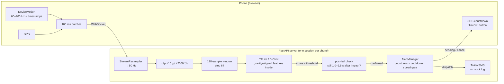
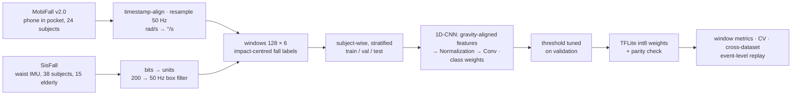
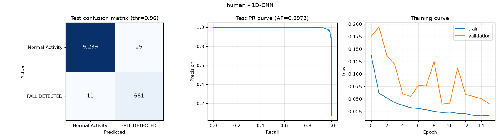

# Passenger Safety & Fall Detection System

**Edge-AI fall and vehicle-crash detection from a smartphone's 6-axis IMU, with a
real-time WebSocket API, a post-fall confirmation stage and a cancellable SOS workflow.**

[](https://github.com/DeveshNathJha/Passenger-Safety-Fall-Detection-System/actions/workflows/ci.yml)


A phone streams accelerometer + gyroscope readings to the server. A 20.5 KB
quantized 1D-CNN scores every 2.56 s window in well under 0.1 ms. A detected fall
becomes an alert only if the person then lies still; the phone shows a 15-second
*"Are you OK?"* countdown, and if nobody cancels, an SMS with a Google-Maps link
goes to an emergency contact.

## Highlights

| | |
|---|---|
| **Accurate on people it has never seen** | held-out test (13 subjects, incl. 3 aged 60–75): recall **98.4 %**, precision **96.4 %**, F1 **0.974**, specificity **99.7 %**; 10-fold subject-wise CV over **62 subjects**: F1 **0.971** |
| **Works however the phone is held** | a rotation-invariant input layer (gravity-aligned features) makes the model invariant *by construction*: F1 with randomly rotated phones = 0.974, identical to upright |
| **Validated across datasets** | trained on MobiFall (phone in pocket) + SisFall (waist sensor, 15 elderly adults); a MobiFall-only model was also tested on SisFall to measure domain shift |
| **Measured like a user experiences it** | event-level evaluation by replaying whole recordings: 374 / 375 SisFall test falls and 57 / 60 MobiFall test falls detected; post-fall stillness check removed 70–81 % of false alarms under domain shift |
| **Edge-ready** | 8.5 k parameters, 20.5 KB int8-weight TFLite, built-in ops only (runs on LiteRT, no Flex delegate), Keras ↔ TFLite decisions identical on 512 test windows |
| **Safety workflow** | per-connection state, candidate → stillness confirmation → cancellable countdown → SMS, cooldown, dispatch even if the phone disconnects, GPS-speed gating for crashes |
| **Engineering** | 111 tests, GitHub Actions CI (lint, tests, training smoke test, Docker build + container smoke test), slim Docker image without TensorFlow, API-key auth, `/metrics` |

> **Project history.** v1 reported 96.65 % accuracy from a random *window-level*
> split with time-misaligned sensor channels. v2 rebuilt the data pipeline and
> evaluation (honest MobiFall LOSO F1: 0.855). v2.1 added rotation-invariant
> inputs (0.948), a second dataset, event-level evaluation and the post-fall check.
> Every issue and decision is documented in [docs/DESIGN.md](docs/DESIGN.md).

## Architecture



The TFLite models are loaded once and shared; every WebSocket connection gets its
own resampler, buffer, post-fall check and alert state.

### Training and evaluation pipeline



## Results

All numbers below are produced by the code in this repository and stored in
[`reports/`](reports) and [`models/*.json`](models).

### 1. Deployed model — held-out subjects

Trained on MobiFall + SisFall (46,784 windows from 62 people). Test = 13 subjects
never used for training or threshold tuning (5 MobiFall, 5 young and 3 elderly SisFall).

| Metric (fall class) | Upright | Phone randomly rotated |
|---|---|---|
| Recall (falls caught) | **98.4 %** (661 / 672) | 98.4 % |
| Precision | **96.4 %** | 96.4 % |
| F1 | **0.974** | 0.974 |
| Specificity | 99.7 % | 99.7 % |
| PR-AUC / ROC-AUC | 0.997 / 1.000 | 0.997 |



### 2. Cross-validation — 62 subjects, 10-fold, subject-wise

Pooled confusion matrix over all folds (every subject is tested exactly once, by a
model that never saw them):

| Test subjects | Precision | Recall | F1 | Specificity |
|---|---|---|---|---|
| **All 62** | 97.4 % | 96.8 % | **0.971** | 99.8 % |
| MobiFall (phone in pocket) | 94.6 % | 92.7 % | 0.936 | 99.6 % |
| SisFall young adults (waist) | 98.5 % | 98.1 % | 0.983 | 99.8 % |
| SisFall elderly, 60–75 y (waist) | 84.6 % | 83.2 % | 0.839 | **99.9 %** |

Elderly fall numbers come from a single person: in SisFall only one elderly
participant (a judo expert) performed falls. The elderly result that matters
most is the false-alarm rate on their daily activities: 18 false windows out of 12,919.

### 3. Why rotation-invariant inputs

The model's first layer turns raw phone-frame axes into six quantities that do not
change when the phone is rotated: total, vertical and horizontal acceleration,
and total, vertical and horizontal rotation rate (vertical = the window's mean gravity direction).

| | MobiFall LOSO, 24 subjects (F1) | 62-subject CV (F1) | Held-out, phone rotated (F1) |
|---|---|---|---|
| Raw axes + rotation augmentation | 0.855 | **0.977** | 0.921 |
| **Rotation-invariant (deployed)** | **0.948** | 0.971 | **0.974** |

Raw axes score marginally higher (+0.006) when every test phone is held exactly like
the training phones, but lose 0.06 F1 as soon as the phone is held differently, which
in real use is the normal case. The invariant model's accuracy cannot depend on
orientation (`tests/test_features.py` checks this, including on the exported TFLite file).

### 4. Cross-dataset generalisation (domain shift)

A model trained **only on MobiFall** (phone in pocket) and tested on **all of SisFall**
(different people, device and body position):

| SisFall, window level | Precision | Recall | F1 | PR-AUC |
|---|---|---|---|---|
| Raw axes | 86.8 % | 81.1 % | 0.839 | 0.923 |
| Rotation-invariant | 40.1 % | 97.0 % | 0.568 | 0.689 |

Under this shift the invariant model raised many false alarms on vigorous waist
movements: fast jogging 67 % of windows, fast stairs 25 %, jumps 24 %. Training on
both datasets closes the gap (SisFall F1 0.98 in section 2). Lesson: test on data
from a different setup before trusting a single-dataset number.

### 5. Event-level results and the post-fall check

Window metrics answer *"is this 2.56 s window a fall?"*. A user experiences *events*,
so [`src/evaluate_events.py`](src/evaluate_events.py) replays whole recordings
through the real streaming pipeline and counts detected falls and false alarms.

The **post-fall check** turns a positive window into a *candidate*. It becomes an alert
only if, 1.0–2.5 s after the impact, the signal is still (std of |acc| ≤ 3 m/s², mean
|gyro| ≤ 60 °/s; thresholds tuned on validation subjects only). Jumping, jogging and
stumbling keep moving, so they are rejected.

| Setting | Falls detected | False alarms |
|---|---|---|
| **Deployed model, SisFall test subjects** (3.1 h of daily activities) | **374 / 375** | 15 (4.9 / h) |
| **Deployed model, MobiFall test subjects** (0.6 h) | **57 / 60** | 2 (car entry 1, car exit 1) |
| MobiFall-only model on all SisFall, check **off** | 1,770 / 1,798 | 1,616 |
| MobiFall-only model on all SisFall, check **on** | 1,744 / 1,798 | **486 (−70 %)** |

With the deployed model the check changes little (−1 false alarm, −1 fall on SisFall),
because training on both datasets already taught the model to reject jogging and
jumping. It is kept as a safety net for unseen conditions, where it removed 70–81 % of
false alarms at a cost of 0.5–1.4 points of recall. The remaining false alarms come
from activities that *end* still (rolling over in bed, collapsing into a chair,
sitting down in a car), so a stillness check cannot separate them. That's the main
open problem.

### 6. Architecture comparison

Same split, rotation-invariant inputs, quantized TFLite on a laptop CPU (MobiFall only):

| Model | Params | TFLite | Latency p50 | Recall | Precision | F1 |
|---|---|---|---|---|---|---|
| **1D-CNN (deployed)** | 8,494 | 20.5 KB | **0.020 ms** | **97.1 %** | 94.4 % | **0.957** |
| Transformer (1 block) | 1,152 | 20.1 KB | 0.065 ms | 84.6 % | 100 % | 0.917 |
| CNN-LSTM | 36,366 | 60.9 KB | 0.207 ms | 95.2 % | 86.8 % | 0.908 |
| LSTM | 20,302 | 42.9 KB | 0.313 ms | 91.4 % | 60.5 % | 0.728 |

The 1D-CNN has the best F1 and recall, is the fastest, and is about as small as the 1-block Transformer.

### 7. Vehicle crash detection — synthetic data

No public labelled smartphone-crash dataset exists, so the crash model is trained on
[physics-informed synthetic data](scripts/generate_car_crash_data.py). That data has
crash pulses clipped to a phone's ±16 g range, spin-outs and rollovers, and hard negatives
(potholes, emergency braking, phone handling, phone drops, some in a parked car).
On held-out sequences it reaches F1 0.996 (118 / 119 crash windows, 0 false positives).
**This only shows the pipeline works**: a model tested on data from its own generator
mostly learns the generator. Crash alerts are therefore also gated on GPS speed and always
go through the stillness check and the cancellable countdown.

## Quick start

```bash
git clone https://github.com/DeveshNathJha/Passenger-Safety-Fall-Detection-System.git
cd Passenger-Safety-Fall-Detection-System

# Option A – Docker (server only, no TensorFlow)
docker compose up --build

# Option B – local
python -m venv .venv && source .venv/bin/activate   # Windows: .venv\Scripts\activate
pip install -r requirements-dev.txt
uvicorn src.app:app --host 0.0.0.0 --port 8000
```

* API docs: `http://localhost:8000/docs`
* Phone demo: `https://<your-pc-ip>:8000/demo` (phones need HTTPS for motion sensors, see [HOW_TO_RUN.md](HOW_TO_RUN.md))
* No phone? Replay a real MobiFall recording through the live server:
  `python scripts/stream_client.py --mobifall <MobiFall>/sub7/FALLS/FOL/FOL_acc_7_1.txt --wait 18`

Copy `.env.example` to `.env` to enable API-key auth and real Twilio SMS.

### Reproduce everything

Datasets (both free, manual download): [MobiFall v2.0](https://www.kaggle.com/datasets/kmknation/mobifall-dataset-v20)
(Kaggle login) and [SisFall](https://www.mdpi.com/1424-8220/17/1/198) (Supplementary Materials).

```bash
python src/preprocess.py --task human   --local-data <dir containing MobiFall_Dataset_v2.0>
python src/preprocess.py --task sisfall --local-data <dir containing SisFall_dataset>
python src/preprocess.py --task car                         # generates the synthetic crash data

python src/train.py --task human                            # deployed model (MobiFall + SisFall, invariant)
python src/train.py --task car
python src/train.py --task human --data mobifall --loso --features invariant   # 24-subject LOSO
python src/train.py --task human --cv 10                     # 62-subject group CV, per-dataset breakdown
python src/train.py --task human --data mobifall --compare  # 4 architectures
python src/cross_dataset.py --features raw                  # MobiFall → SisFall (also: invariant)
python src/evaluate_events.py --task sisfall --subjects test   # event level, check off vs on
python src/evaluate_events.py --task human --loso              # event-level LOSO (slow)
```

## API

| Endpoint | Description |
|---|---|
| `GET /health` | liveness, loaded models, active sessions |
| `GET /models` | threshold, size, training data and test metrics of each model |
| `GET /metrics` | counters (inferences, candidates confirmed / rejected, alerts) and latency p50/p95/p99 |
| `POST /predict/window` | stateless scoring of one 128 × 6 window |
| `WS /ws/predict?model=human\|car` | streaming inference + post-fall check + alert workflow |
| `GET /demo` | phone demo page |

**WebSocket messages**

```jsonc
// client → server
{"type": "batch", "samples": [{"acc_x": 0.1, "acc_y": 9.8, "acc_z": 0.3,
                               "gyro_x": 1.2, "gyro_y": -0.4, "gyro_z": 0.0,
                               "t": 1712.5, "latitude": 12.97, "longitude": 77.59, "speed_kmh": 42}]}
{"type": "cancel_alert", "alert_id": 3}

// server → client
{"event": "prediction", "label": "Normal Activity", "is_event": false, "candidate": true, "raw_score": 0.9998, ...}
{"event": "confirmation", "is_event": true, "label": "FALL DETECTED",
 "stillness": {"acc_std": 0.04, "gyro_mean": 2.0}, "delay_s": 2.48, ...}
{"event": "alert_pending", "alert": {"id": 3, "label": "FALL DETECTED", ...}, "countdown_s": 15}
{"event": "alert_cancelled" | "alert_dispatched" | "alert_failed" | "alert_suppressed", ...}
```

Units: acceleration in m/s² including gravity, rotation rate in °/s, `t` in ms
(optional; when present the server resamples to 50 Hz).

## Project structure

```
├── config/config.yaml            # hyper-parameters, thresholds, post-fall check, alert policy
├── src/
│   ├── preprocess.py             # MobiFall parsing, sync, resampling, windowing, recordings
│   ├── sisfall.py                # SisFall loader (bits → units, 200 → 50 Hz)
│   ├── signal_processing.py      # resampling, windows, rotation augmentation, invariant features
│   ├── model_layers.py           # GravityAlignedFeatures Keras layer (exported into TFLite)
│   ├── train.py                  # 4 architectures, stratified subject-wise splits, LOSO / CV, export
│   ├── tflite_converter.py       # quantization + Keras/TFLite parity check
│   ├── inference.py              # TFLiteModel, ModelRegistry, StreamSession, PostFallCheck
│   ├── alerts.py                 # SOS state machine (countdown, cancel, cooldown, speed gate)
│   ├── app.py                    # FastAPI app factory, REST + WebSocket
│   ├── evaluate_events.py        # event-level replay evaluation, check tuning, event LOSO
│   ├── cross_dataset.py          # train MobiFall → test SisFall
│   ├── demo_phone.html           # phone client
│   └── utils/                    # config loader, logging, Twilio / mock notifier
├── scripts/                      # synthetic crash generator, live-server replay client
├── models/                       # *.tflite (deployed) + *.json metadata + *.keras
├── reports/                      # every metric quoted in this README (JSON) + plots
├── tests/                        # 111 tests
├── docs/DESIGN.md                # design decisions, v1 → v2 → v2.1, limitations
├── Dockerfile · docker-compose.yml · .github/workflows/ci.yml
```

## Testing

```bash
pytest          # 111 tests, ~1 min
ruff check .
```

The API, alert and post-fall-check tests use a deterministic fake model, so the
streaming, isolation, candidate/confirmation, countdown/cancel/cooldown, disconnect and
auth logic is covered without TensorFlow. Other tests check the real TFLite files
(metadata, split integrity, parity, size), that the invariant layer matches its NumPy
reference and is rotation-invariant after TFLite export, and the SisFall unit conversion.

## Limitations & next steps

* **Simulated falls.** Both datasets contain falls acted out on mats; only one elderly
  person performed falls. Validating on real-world falls of older adults (e.g. FARSEEING)
  is the most important next step.
* **Activities that end still** (lying down quickly, rolling over in bed, collapsing into a
  chair, sitting down in a car) remain the main source of false alarms; the stillness check
  cannot separate them. Next: posture-change features, or a short sequence model over the
  minute after the candidate.
* **Placements.** Training data covers trouser pocket and waist; bag, hand and car mount are
  covered only by the invariance guarantee, not by data.
* **Crash model** trained on synthetic data only.
* **On-device inference** (TFLite in an Android app) would make detection work offline; the
  server would then only relay SOS messages.

## License

MIT — see [LICENSE](LICENSE).
